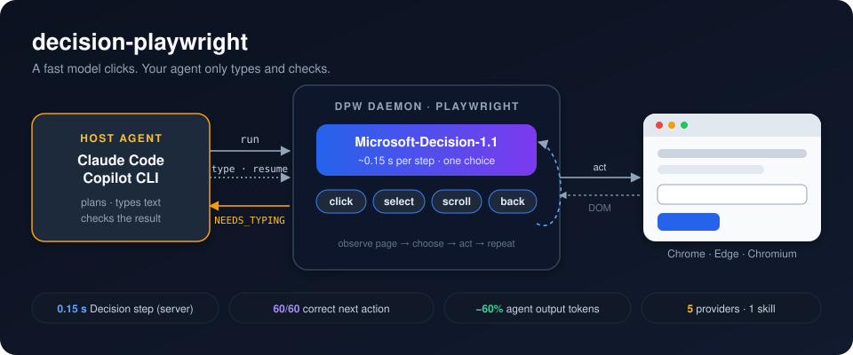
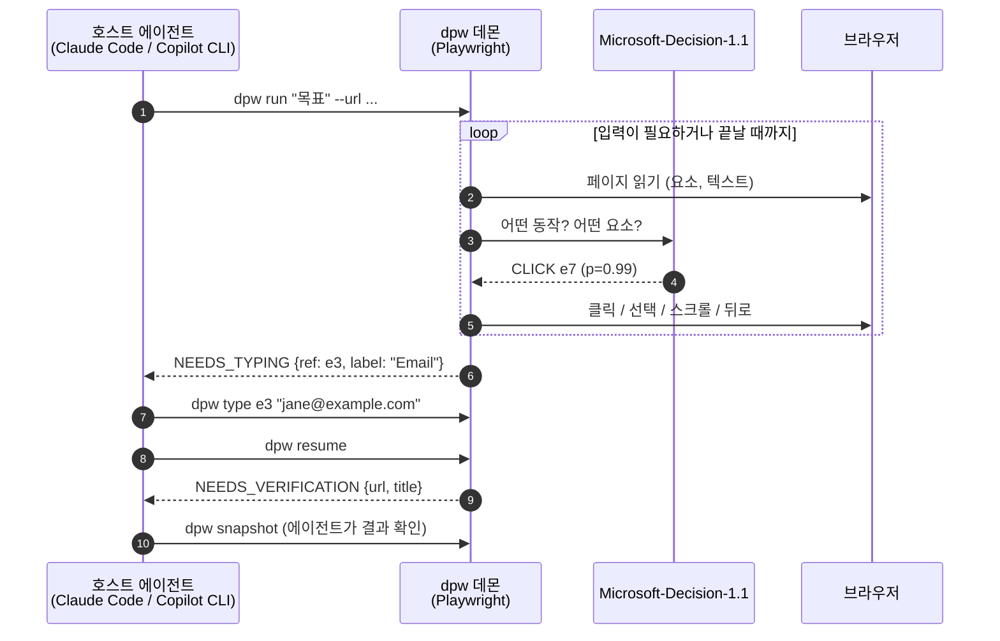
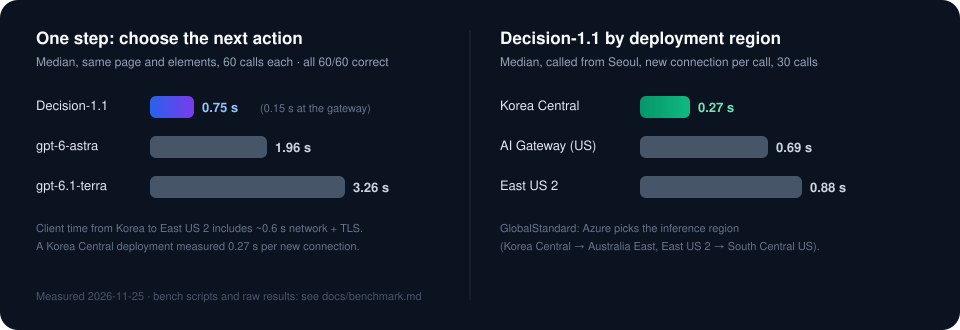

<p align="right"><a href="README.md">English</a> · <b>한국어</b></p>

<p align="center">
  
</p>

<p align="center">
  <b>Claude Code</b>와 <b>GitHub Copilot CLI</b>용 <b>에이전트 스킬</b>입니다.<br>
  실제 브라우저에서 클릭, 드롭다운 선택, 스크롤, 뒤로 가기는 <b>Microsoft-Decision-1.1</b>이 고릅니다.<br>
  에이전트의 LLM은 글자 입력과 결과 확인만 합니다.
</p>

<p align="center">
  <a href="#설치">설치</a> ·
  <a href="#동작-방식">동작 방식</a> ·
  <a href="#provider-설정">Provider</a> ·
  <a href="#벤치마크">벤치마크</a> ·
  <a href="#옵션">옵션</a>
</p>

---

## 왜 쓰나

| | 에이전트가 Playwright를 직접 씀 | **decision-playwright** |
|---|---|---|
| 클릭을 누가 고르나 | 큰 LLM. 한 단계에 한 턴 (2~3초) | Decision-1.1. 한 단계에 호출 1번 (서버 0.15초) |
| 에이전트가 쓰는 것 | 셀렉터와 Playwright 스크립트. 실패하면 고침 | 입력칸에 넣을 글자만. 예: `"Jane Doe"` |
| 출력 토큰 (테스트 페이지 과제) | 968 | **389** (−60%) |
| 긴 페이지, 폼, 로그인 | 에이전트가 페이지를 읽고 판단 | 기본 기능: 요소 순위, 제출 확인, 재시도 |

## 동작 방식



| 상태 | 에이전트가 할 일 |
|---|---|
| `NEEDS_TYPING` | 목표를 보고 넣을 글자를 정함 → `dpw type <ref> "<글자>"` → `dpw resume` |
| `NEEDS_VERIFICATION` | `dpw snapshot` 으로 페이지를 확인. Decision 결과는 증거가 아님 |
| `BLOCKED` / `STEP_LIMIT` | `dpw snapshot` → 막힌 한 단계만 직접 함 (`type`, `open`, `press`) → `dpw resume` |

## 설치

필요한 것: **Node.js 18 이상**, Chrome 또는 Edge. 둘 다 없으면 Chromium을 한 번 내려받습니다.
처음 실행할 때 `playwright-core` 를 `~/.decision-playwright/runtime` 에 자동으로 설치합니다.
그래서 `npm install` 단계가 없습니다.

**모든 에이전트** ([skills CLI](https://skills.sh)). Claude Code, Copilot CLI 등 40개 이상의 에이전트를 찾아서 설치합니다:

```bash
npx skills add cheolmin/decision-playwright -g
```

**GitHub CLI** v2.90 이상:

```bash
gh skill install cheolmin/decision-playwright decision-playwright --scope user --agent github-copilot
gh skill install cheolmin/decision-playwright decision-playwright --scope user --agent claude-code
```

**Claude Code 플러그인** (나중에 `/plugin update` 로 업데이트):

```text
/plugin marketplace add cheolmin/decision-playwright
/plugin install decision-playwright@cheolmin
```

설치를 확인합니다. 런타임을 설치하고, 브라우저를 켜 보고, provider 설정을 보여 줍니다:

```bash
node ~/.claude/skills/decision-playwright/scripts/dpw.mjs setup     # 또는 ~/.agents/skills/... / ~/.copilot/skills/...
```

<details>
<summary>직접 설치</summary>

```bash
git clone https://github.com/cheolmin/decision-playwright.git
cp -r decision-playwright/skills/decision-playwright ~/.claude/skills/    # 또는 ~/.copilot/skills/
```

한 프로젝트에만 쓰려면 `<project>/.claude/skills/` 또는 `<project>/.github/skills/` 에 복사합니다.
</details>

팁: 승인 창 때문에 반복이 멈추지 않게 명령을 허용해 두세요. 예:
`copilot --allow-tool 'shell(node)'`, 또는 Claude Code 권한에 `Bash(node:*)` 추가.

## 빠른 시작

```bash
export DECISION_PROVIDER=aigateway                       # "Provider 설정" 참고
export AIGATEWAY_URL=my-gw.eastus2-01.ai.gateway.azure.com
export AIGATEWAY_API_KEY=...
export DECISION_MODEL=my-foundry/decision-1-1
```

그다음 에이전트에게 말합니다: *"decision-playwright로 saucedemo.com에 standard_user로 로그인해서 백팩을 사 줘."*
직접 실행해도 됩니다:

```bash
DPW="node ~/.claude/skills/decision-playwright/scripts/dpw.mjs"
$DPW run "Search for red shoes sorted by price" --url https://shop.example.com
# {"status":"NEEDS_TYPING","target":{"ref":"e3","label":"Query"},"timing":{...}}
$DPW type e3 "red shoes"
$DPW resume
# {"status":"NEEDS_VERIFICATION","page":{"url":".../results?q=red+shoes&sort=price"}}
$DPW stop
```

목표에 입력값이 이미 있으면 `--fill` 로 넘기세요. 그 칸에서는 Decision이 멈추지 않습니다:

```bash
$DPW run "Log in and check out" --url https://www.saucedemo.com/ \
  --fill '{"Username":"standard_user","Password":"secret_sauce","First Name":"Jane","Last Name":"Doe","Postal Code":"12345"}'
```

## Provider 설정

비밀 값은 환경 변수에서만 읽습니다. 셸 프로필이나 비밀 관리 도구에 두세요. 저장소에는 절대
넣지 마세요. `dpw config` 는 실제로 쓸 URL과 모델을 보여 줍니다 (비밀 값은 보여 주지 않음).

| `DECISION_PROVIDER` | 엔드포인트 | 인증 | 테스트 |
|---|---|---|---|
| `aigateway` | Azure AI Gateway (`*.ai.gateway.azure.com`) | 게이트웨이 API 키 (Bearer) | ✅ 실제 |
| `endpoint` | 아무 URL. 예: Foundry `/systemone` | Bearer 키 또는 Entra ID 토큰 | ✅ 실제 |
| `foundry` | `https://<resource>.services.ai.azure.com` | `api-key` | mock |
| `apim` | Azure API Management | 구독 키 | mock |
| `typesafe` | TypeSafe Jev (기본값) | Bearer 키 | mock |

<details>
<summary><b>Azure AI Gateway</b> (<code>aigateway</code>)</summary>

```bash
export DECISION_PROVIDER=aigateway
export AIGATEWAY_URL=my-gw.eastus2-01.ai.gateway.azure.com   # properties.frontend.defaultHostname
export AIGATEWAY_API_KEY=...                                 # 게이트웨이 런타임 API 키
export DECISION_MODEL=my-foundry/decision-1-1                # 게이트웨이 모델 별칭
```

Decision에는 chat 경로가 없습니다. 배포를 System One 경로로 등록하고 별칭을 만드세요
(`az aigateway` CLI 확장):

```bash
az aigateway model create -g <gw-rg> --gateway-name <gw> \
  --foundry-resource-id <foundry-account-id> --deployment <decision-deployment> \
  -n decision-1-1 --supported-endpoints '["/providers/microsoft/v1/systemone"]'
az aigateway model-alias create -g <gw-rg> --gateway-name <gw> \
  -n <provider>-decision-1-1 --routing-name <provider>/decision-1-1 \
  --backend-model resource-id=<provider>/models/decision-1-1
az aigateway api-key create -g <gw-rg> --gateway-name <gw> --name dpw
export AIGATEWAY_API_KEY=$(az aigateway api-key list-secrets -g <gw-rg> --gateway-name <gw> --name dpw --query primaryKey -o tsv)
```

모델 이름은 소문자여야 합니다. 배포 이름에 `Microsoft` 를 넣을 수 없습니다.
선택: `AIGATEWAY_PATH` (기본값 `/default/models/providers/microsoft/v1/systemone`).
</details>

<details>
<summary><b>사용자 지정 엔드포인트</b> (<code>endpoint</code>): Entra ID로 Foundry, LiteLLM, 프록시</summary>

```bash
export DECISION_PROVIDER=endpoint
export DECISION_ENDPOINT_URL=https://<resource>.services.ai.azure.com/providers/microsoft/v1/systemone
export DECISION_API_KEY=$(az account get-access-token --resource https://cognitiveservices.azure.com --query accessToken -o tsv)
export DECISION_MODEL=<deployment-name>
# 선택: 기본 헤더는 "Authorization: Bearer <key>"
export DECISION_AUTH_HEADER=api-key
export DECISION_AUTH_SCHEME=          # 비우면 키만 보냄
```
</details>

<details>
<summary><b>Azure AI Foundry API 키</b> (<code>foundry</code>)</summary>

```bash
export DECISION_PROVIDER=foundry
export FOUNDRY_RESOURCE=my-resource             # 또는 FOUNDRY_ENDPOINT=<전체 기본 URL>
export FOUNDRY_API_KEY=...                      # api-key 헤더로 보냄
export DECISION_DEPLOYMENT=<deployment-name>
```

요청: `POST https://<resource>.services.ai.azure.com/providers/microsoft/v1/systemone`.
</details>

<details>
<summary><b>Azure API Management</b> (<code>apim</code>)</summary>

```bash
export DECISION_PROVIDER=apim
export APIM_GATEWAY_URL=https://my-apim.azure-api.net/foundry
export APIM_SUBSCRIPTION_KEY=...
export DECISION_MODEL=Microsoft-Decision-1.1
export APIM_KEY_HEADER=Ocp-Apim-Subscription-Key   # 선택, 또는 api-key
export APIM_PATH=/providers/microsoft/v1/systemone  # 선택
```

APIM의 API가 `/systemone` 동작을 Foundry 백엔드로 보내야 합니다.
</details>

<details>
<summary><b>TypeSafe Jev</b> (<code>typesafe</code>, 기본값)</summary>

```bash
export DECISION_PROVIDER=typesafe
export TYPESAFE_API_KEY=...
export TYPESAFE_MODEL=jev-latest
```
</details>

> **사용자 가까운 리전에 배포하세요.** 서울에서 호출하면 Korea Central 배포는 새 연결마다
> **0.27초**, East US 2는 0.88초였습니다. 차이의 대부분은 네트워크와 TLS 연결 시간입니다.

## 벤치마크

### 에이전트가 모르는 페이지: 스킬이 더 빠름

이 벤치마크용으로 만든 페이지 5개입니다. `data-test` 같은 표시가 없습니다: 정렬 검색, 설정
(체크박스 2개, 드롭다운 2개), 링크 300개 중 1개 찾기, 가입 폼 (텍스트, 드롭다운, 라디오, 체크박스),
상품 24개 장바구니. 과제당 3회.

| 호스트 모델 | **스킬 있음** | 스킬 없음 | 빨라짐 | 에이전트 출력 토큰 |
|---|---|---|---|---|
| gpt-6.1-terra | **55초** · 15/15 | 89초 · 15/15 | **−38%** | **389** vs 968 (−60%) |
| gpt-6-astra | **133초** · 15/15 | 182초 · 15/15 | **−27%** | **447** vs 785 (−43%) |

| 과제 (gpt-6.1-terra) | **스킬 있음** | 스킬 없음 | |
|---|---|---|---|
| 장바구니: 24개 중 2개 담고 결제 | **44.5초** | 142.8초 | **3.2배 빠름** |
| 가입 폼 | **54.7초** | 87.1초 | −37% |
| 링크 300개 중 1개 | **47.0초** | 67.9초 | −31% |
| 설정 | **63.1초** | 77.5초 | −19% |
| 정렬 검색 | **66.9초** | 71.3초 | −6% |

스킬이 없으면 에이전트가 Playwright 스크립트를 쓰고, 실행하고, 오류를 읽고, 셀렉터를 고칩니다
(과제당 도구 시간 39초). 스킬을 쓰면 요소는 Decision-1.1이 고르고, 에이전트는 셀렉터를 쓰지 않습니다
(12초). Decision 자체는 호출 6번에 2.9초로, 세션 시간의 5%였습니다.

<p align="center"></p>

### 쉽고 유명한 데모 사이트: 턴이 늘어서 Playwright 직접 사용이 빠름

saucedemo, the-internet, books.toscrape, Wikipedia는 요소에 `data-test` id나 고유한 텍스트가
있습니다. 그래서 에이전트가 처음 쓴 Playwright 스크립트가 매번 성공했고, 2턴이면 끝났습니다.
스킬은 항상 약 5턴이 듭니다 (스킬 로드 → `dpw run` → 확인 → 종료 → 답변). 그래서 여기서는 느립니다:

| 실제 사이트, 브라우저 창 보임, gpt-6.1-terra | 스킬 있음 (`--fill`) | 스킬 없음 |
|---|---|---|
| 6개 과제 평균 · 성공 | 36.3초 · 18/18 | **26.0초** · 18/18 |
| 에이전트 턴 | 5.9 | **2.2** |
| saucedemo 결제 (입력칸 5개) | 40.9초 (v0.2: 66.6초) | **29.5초** |

`--fill` 로 입력칸마다 늘던 턴은 이미 없앴습니다 (saucedemo 결제 전체가 `dpw run` 한 번).
남은 차이는 고정된 턴 수 때문입니다. 안정적인 스크립트 하나로 충분하면 Playwright를 바로 쓰세요.

방법, 원본 수치, 게이트웨이 추적: [docs/benchmark.md](docs/benchmark.md) (영어).
로컬 에이전트는 LiteLLM을 거친 Claude Code입니다. 세션마다 실제 모델을 확인했습니다.
성공은 에이전트의 답이 아니라, 사이트가 실제로 보여 준 페이지로 판정했습니다.

## 옵션

| 변수 | 뜻 |
|---|---|
| `DPW_HEADED=1` | 브라우저 창을 보여 줌 |
| `DPW_CHANNEL` / `DPW_EXECUTABLE_PATH` | 브라우저 지정 (`chrome`, `msedge` 또는 경로). 기본 순서: Playwright Chromium, Chrome, Edge |
| `DPW_RECORD_DIR` | 세션을 WebM으로 녹화. `dpw stop` 이 파일 경로를 알려 줌 |
| `DPW_SESSION` / `--session` | 세션 이름. 세션마다 브라우저 1개 (기본값 `default`) |
| `DPW_MAX_STEPS` | `run`/`resume` 한 번에 Decision 단계 수 (기본값 40) |
| `DPW_MAX_ELEMENTS` | Decision에 보내는 요소 수 (기본값 80). 목표의 드문 단어와 숫자가 맞는 요소가 먼저 |
| `DECISION_BLOCKED_MIN` | 이 확률보다 약한 `BLOCKED` 이고 빈 입력칸이 있으면 다음 동작을 씀 (기본값 0.8) |
| `DPW_SUBMIT_BEFORE_DONE=0` | 바꾸고 제출하지 않은 폼을 자동 제출하는 기능을 끔 |
| `DPW_STATE_DIR` | 상태와 런타임 폴더 (기본값 `~/.decision-playwright`) |
| `DECISION_MAX_PAGE_CHARS` | Decision에 보내는 페이지 텍스트 길이 (기본값 12000) |
| `DECISION_TIMEOUT_MS` | 요청 제한 시간 (기본값 30000) |

모든 `run`/`resume` 결과에 `timing` 이 있습니다: `decisionApiMs`, `decisionCalls`, `observeMs`, `actMs`, `totalMs`.

## 보안

- 데몬은 `127.0.0.1` 에서만 듣습니다. `0600` 파일에 저장한 무작위 토큰이 있어야 합니다.
- provider 오류 본문은 출력하지 않습니다. API 키는 환경 변수에서만 읽습니다.
- 비밀번호 칸은 `sensitive` 로 표시합니다. 값은 가리고, Decision에 보내지 않습니다.
  그 밖에 입력한 글자(최대 80자)는 `recent_actions` 로 Decision에 보냅니다.
- 페이지 텍스트는 신뢰하지 않는 데이터로 Decision에 보냅니다. 지시로 쓰지 않습니다.

## 라이선스

MIT
