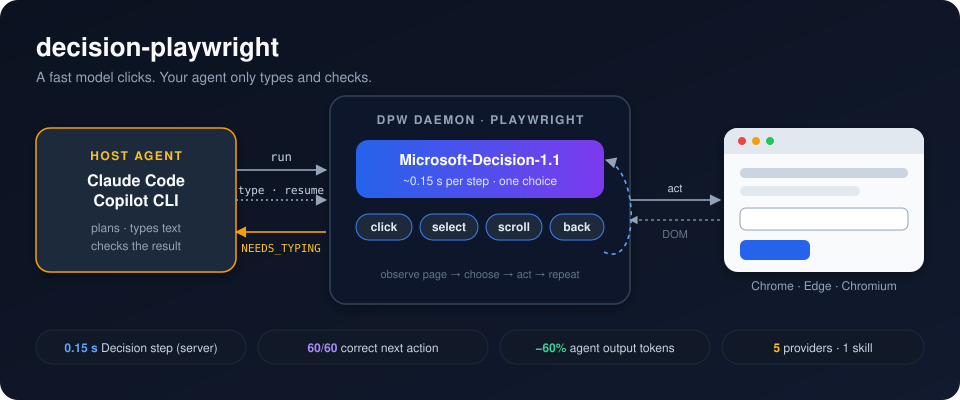
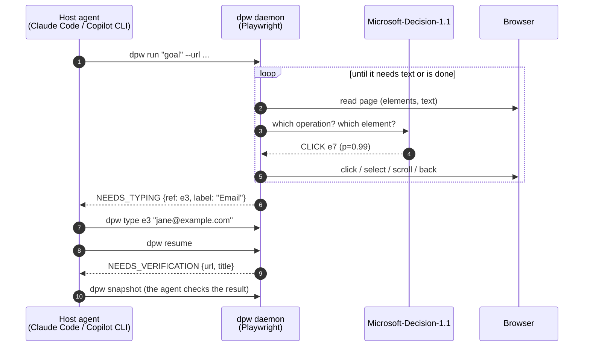
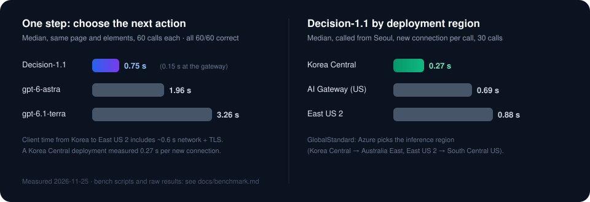

<p align="right"><b>English</b> · <a href="README.ko.md">한국어</a></p>

<p align="center">
  
</p>

<p align="center">
  An <b>Agent Skill</b> for <b>Claude Code</b> and <b>GitHub Copilot CLI</b>.<br>
  <b>Microsoft-Decision-1.1</b> picks every click, dropdown option, scroll and back step in a real browser.<br>
  Your agent's LLM only types text and checks the result.
</p>

<p align="center">
  <a href="#install">Install</a> ·
  <a href="#how-it-works">How it works</a> ·
  <a href="#configure-a-provider">Providers</a> ·
  <a href="#benchmarks">Benchmarks</a> ·
  <a href="#options">Options</a>
</p>

---

## Why

| | Agent drives Playwright itself | **decision-playwright** |
|---|---|---|
| Who picks each click | The big LLM, one turn per step (2–3 s) | Decision-1.1, one call per step (0.15 s at the server) |
| What the agent writes | Selectors and Playwright scripts, then fixes them | Only the text for a field, e.g. `"Jane Doe"` |
| Output tokens (test-page tasks) | 968 | **389** (−60%) |
| Long pages, forms, logins | The agent reads the page and decides | Built in: element ranking, submit before done, retries |

## How it works



| Status | What the agent does |
|---|---|
| `NEEDS_TYPING` | Decide the text from the goal → `dpw type <ref> "<text>"` → `dpw resume` |
| `NEEDS_VERIFICATION` | Check the page with `dpw snapshot`. Decision output is never proof |
| `BLOCKED` / `STEP_LIMIT` | `dpw snapshot`, do the one stuck step (`type`, `open`, `press`), then `dpw resume` |

## Install

Requirements: **Node.js 18+** and Chrome or Edge. If neither is found, Chromium is downloaded once.
The first command installs `playwright-core` into `~/.decision-playwright/runtime`, so there is
no `npm install` step.

**Any agent** with the [skills CLI](https://skills.sh) (finds Claude Code, Copilot CLI and 40+ other agents):

```bash
npx skills add cheolmin/decision-playwright -g
```

**GitHub CLI** v2.90+:

```bash
gh skill install cheolmin/decision-playwright decision-playwright --scope user --agent github-copilot
gh skill install cheolmin/decision-playwright decision-playwright --scope user --agent claude-code
```

**Claude Code plugin** (update later with `/plugin update`):

```text
/plugin marketplace add cheolmin/decision-playwright
/plugin install decision-playwright@cheolmin
```

Check the install. This installs the runtime, starts a browser and shows the provider:

```bash
node ~/.claude/skills/decision-playwright/scripts/dpw.mjs setup     # or ~/.agents/skills/... / ~/.copilot/skills/...
```

<details>
<summary>Manual install</summary>

```bash
git clone https://github.com/cheolmin/decision-playwright.git
cp -r decision-playwright/skills/decision-playwright ~/.claude/skills/    # or ~/.copilot/skills/
```

For one project only, copy to `<project>/.claude/skills/` or `<project>/.github/skills/`.
</details>

Tip: allow the command so approval prompts do not stop the loop, for example
`copilot --allow-tool 'shell(node)'`, or add `Bash(node:*)` to the Claude Code permissions.

## Quick start

```bash
export DECISION_PROVIDER=aigateway                       # see "Configure a provider"
export AIGATEWAY_URL=my-gw.eastus2-01.ai.gateway.azure.com
export AIGATEWAY_API_KEY=...
export DECISION_MODEL=my-foundry/decision-1-1
```

Then ask your agent: *"Use decision-playwright to log in to saucedemo.com as standard_user and buy a backpack."*
Or drive it by hand:

```bash
DPW="node ~/.claude/skills/decision-playwright/scripts/dpw.mjs"
$DPW run "Search for red shoes sorted by price" --url https://shop.example.com
# {"status":"NEEDS_TYPING","target":{"ref":"e3","label":"Query"},"timing":{...}}
$DPW type e3 "red shoes"
$DPW resume
# {"status":"NEEDS_VERIFICATION","page":{"url":".../results?q=red+shoes&sort=price"}}
$DPW stop
```

If the goal already has the text, pass it with `--fill` and Decision will not stop for those fields:

```bash
$DPW run "Log in and check out" --url https://www.saucedemo.com/ \
  --fill '{"Username":"standard_user","Password":"secret_sauce","First Name":"Jane","Last Name":"Doe","Postal Code":"12345"}'
```

## Configure a provider

Secrets come only from environment variables. Keep them in your shell profile or a secret
manager, never in the repository. `dpw config` shows the resolved URL and model (no secrets).

| `DECISION_PROVIDER` | Endpoint | Auth | Tested |
|---|---|---|---|
| `aigateway` | Azure AI Gateway (`*.ai.gateway.azure.com`) | Gateway API key (Bearer) | ✅ live |
| `endpoint` | Any URL, e.g. Foundry `/systemone` | Bearer key or Entra ID token | ✅ live |
| `foundry` | `https://<resource>.services.ai.azure.com` | `api-key` | mock |
| `apim` | Azure API Management | Subscription key | mock |
| `typesafe` | TypeSafe Jev (default) | Bearer key | mock |

<details>
<summary><b>Azure AI Gateway</b> (<code>aigateway</code>)</summary>

```bash
export DECISION_PROVIDER=aigateway
export AIGATEWAY_URL=my-gw.eastus2-01.ai.gateway.azure.com   # properties.frontend.defaultHostname
export AIGATEWAY_API_KEY=...                                 # gateway runtime API key
export DECISION_MODEL=my-foundry/decision-1-1                # gateway model alias
```

Decision has no chat route. Register the deployment with the System One path and give it an
alias (`az aigateway` CLI extension):

```bash
az aigateway model create -g <gw-rg> --gateway-name <gw> \
  --foundry-resource-id <foundry-account-id> --deployment <decision-deployment> \
  -n decision-1-1 --supported-endpoints '["/providers/microsoft/v1/systemone"]'
az aigateway model-alias create -g <gw-rg> --gateway-name <gw> \
  -n <provider>-decision-1-1 --routing-name <provider>/decision-1-1 \
  --backend-model resource-id=<provider>/models/decision-1-1
az aigateway api-key create -g <gw-rg> --gateway-name <gw> --name dpw
export AIGATEWAY_API_KEY=$(az aigateway api-key list-secrets -g <gw-rg> --gateway-name <gw> --name dpw --query primaryKey -o tsv)
```

The model name must be lowercase. A deployment name may not contain `Microsoft`.
Optional: `AIGATEWAY_PATH` (default `/default/models/providers/microsoft/v1/systemone`).
</details>

<details>
<summary><b>Custom endpoint</b> (<code>endpoint</code>): Foundry with Entra ID, LiteLLM, proxies</summary>

```bash
export DECISION_PROVIDER=endpoint
export DECISION_ENDPOINT_URL=https://<resource>.services.ai.azure.com/providers/microsoft/v1/systemone
export DECISION_API_KEY=$(az account get-access-token --resource https://cognitiveservices.azure.com --query accessToken -o tsv)
export DECISION_MODEL=<deployment-name>
# optional: the default header is "Authorization: Bearer <key>"
export DECISION_AUTH_HEADER=api-key
export DECISION_AUTH_SCHEME=          # empty = raw key
```
</details>

<details>
<summary><b>Azure AI Foundry API key</b> (<code>foundry</code>)</summary>

```bash
export DECISION_PROVIDER=foundry
export FOUNDRY_RESOURCE=my-resource             # or FOUNDRY_ENDPOINT=<full base URL>
export FOUNDRY_API_KEY=...                      # sent as the api-key header
export DECISION_DEPLOYMENT=<deployment-name>
```

Request: `POST https://<resource>.services.ai.azure.com/providers/microsoft/v1/systemone`.
</details>

<details>
<summary><b>Azure API Management</b> (<code>apim</code>)</summary>

```bash
export DECISION_PROVIDER=apim
export APIM_GATEWAY_URL=https://my-apim.azure-api.net/foundry
export APIM_SUBSCRIPTION_KEY=...
export DECISION_MODEL=Microsoft-Decision-1.1
export APIM_KEY_HEADER=Ocp-Apim-Subscription-Key   # optional, or api-key
export APIM_PATH=/providers/microsoft/v1/systemone  # optional
```

The APIM API must forward the `/systemone` operation to the Foundry backend.
</details>

<details>
<summary><b>TypeSafe Jev</b> (<code>typesafe</code>, default)</summary>

```bash
export DECISION_PROVIDER=typesafe
export TYPESAFE_API_KEY=...
export TYPESAFE_MODEL=jev-latest
```
</details>

> **Deploy near your users.** Called from Seoul, a Korea Central deployment answered in
> **0.27 s** per new connection and East US 2 in 0.88 s. Most of the difference is network and TLS setup.

## Benchmarks

### Pages the agent does not know: the skill is faster

Five tasks on pages written for this benchmark, with no `data-test` hooks: search with sort,
settings (2 checkboxes, 2 dropdowns), one link among 300, a signup form (text, dropdown,
radio, checkboxes), and a cart with 24 items. 3 runs each.

| Host model | **With skill** | Without skill | Faster | Agent output tokens |
|---|---|---|---|---|
| gpt-6.1-terra | **55 s** · 15/15 | 89 s · 15/15 | **−38%** | **389** vs 968 (−60%) |
| gpt-6-astra | **133 s** · 15/15 | 182 s · 15/15 | **−27%** | **447** vs 785 (−43%) |

| Task (gpt-6.1-terra) | **With skill** | Without skill | |
|---|---|---|---|
| Cart: add 2 of 24 items, check out | **44.5 s** | 142.8 s | **3.2× faster** |
| Signup form | **54.7 s** | 87.1 s | −37% |
| One link among 300 | **47.0 s** | 67.9 s | −31% |
| Settings | **63.1 s** | 77.5 s | −19% |
| Search with sort | **66.9 s** | 71.3 s | −6% |

Without the skill, the agent writes a Playwright script, runs it, reads the error and fixes the
selectors (39 s of tool time per task). With the skill, Decision-1.1 picks each element and the
agent never writes a selector (12 s). Decision itself used 2.9 s for 6 calls, 5% of the session.

<p align="center"></p>

### Easy, well-known demo sites: more turns, so plain Playwright wins

On saucedemo, the-internet, books.toscrape and Wikipedia, elements have `data-test` ids or
unique text. The agent's first Playwright script worked every time, in 2 turns. The skill always
takes about 5 (load skill → `dpw run` → check → stop → answer), so it is slower there:

| Real sites, visible browser, gpt-6.1-terra | With skill (`--fill`) | Without skill |
|---|---|---|
| Mean of 6 tasks · success | 36.3 s · 18/18 | **26.0 s** · 18/18 |
| Agent turns | 5.9 | **2.2** |
| saucedemo checkout (5 text fields) | 40.9 s (v0.2: 66.6 s) | **29.5 s** |

`--fill` already removed one turn per text field (the whole saucedemo checkout is one `dpw run`).
The remaining gap is the fixed turn count. Use plain Playwright when one stable script is enough.

Method, raw numbers and the gateway trace: [docs/benchmark.md](docs/benchmark.md).
Local agent: Claude Code through LiteLLM; the model was checked in every session. Success is the
page the site actually served, not the agent's answer.

## Options

| Variable | Meaning |
|---|---|
| `DPW_HEADED=1` | Show the browser window |
| `DPW_CHANNEL` / `DPW_EXECUTABLE_PATH` | Force a browser (`chrome`, `msedge` or a path). Default order: Playwright Chromium, Chrome, Edge |
| `DPW_RECORD_DIR` | Record the session as WebM. `dpw stop` returns the file paths |
| `DPW_SESSION` / `--session` | Session name, one browser per session (default `default`) |
| `DPW_MAX_STEPS` | Decision steps per `run`/`resume` (default 40) |
| `DPW_MAX_ELEMENTS` | Elements sent to Decision (default 80). Rare goal words and numbers rank first |
| `DECISION_BLOCKED_MIN` | A weak `BLOCKED` below this probability, with an empty field, falls back to the next operation (default 0.8) |
| `DPW_SUBMIT_BEFORE_DONE=0` | Turn off the automatic submit of a changed form that was not sent |
| `DPW_STATE_DIR` | State and runtime folder (default `~/.decision-playwright`) |
| `DECISION_MAX_PAGE_CHARS` | Page text sent to Decision (default 12000) |
| `DECISION_TIMEOUT_MS` | Request timeout (default 30000) |

Every `run`/`resume` result has `timing`: `decisionApiMs`, `decisionCalls`, `observeMs`, `actMs`, `totalMs`.

## Security

- The daemon listens on `127.0.0.1` only and needs a random token stored in a `0600` file.
- Provider error bodies are never printed. API keys come only from environment variables.
- Password fields are marked `sensitive`. Their values are masked and are not sent to Decision.
  Other text that you type (up to 80 characters) is sent to Decision in `recent_actions`.
- Page text goes to Decision as untrusted data, never as instructions.

## License

MIT
